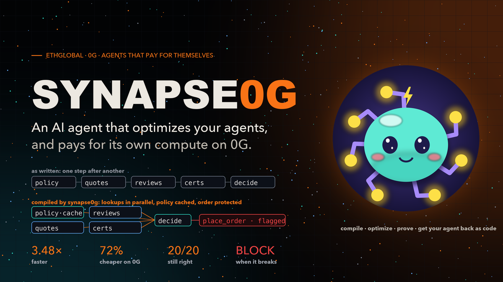
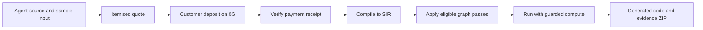
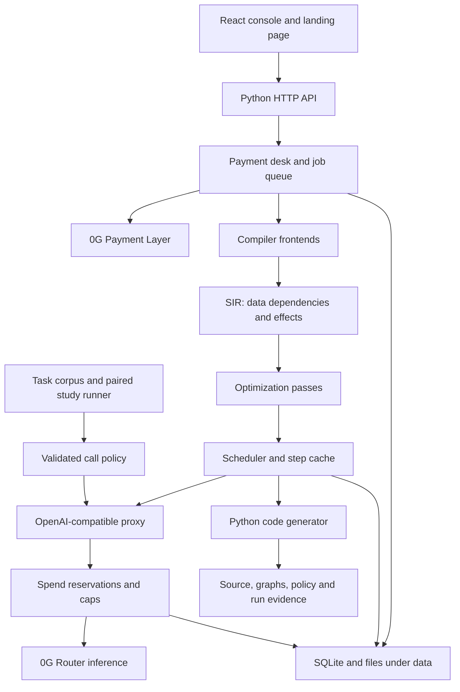
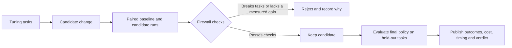

# Synapse0g



**An AI agent that optimizes other AI agents, and pays for its own compute on 0G.**

You bring an agent. Synapse0g compiles it into a graph, rebuilds it to run faster and cheaper,
checks outcomes on benchmark tasks where a test set is available, and hands the optimized agent
back to you **as code**. A pasted sample alone does not establish correctness across other inputs. You pay
it in 0G, straight into its 0G compute account, and every model call it makes for your job is paid
from that balance, with 0G's request id and exact charge.

- **Demo routes after deployment:** `/` (landing page) · `/#/pay` (the console); see the deployment guide for setup.
- **Network:** 0G mainnet (chain 16661) · inference on the 0G Router · payments on 0G's Payment Layer
- **Results:** [RESULTS.md](RESULTS.md) · **Deploy:** [docs/DEPLOY.md](docs/DEPLOY.md) · **Payments:** [docs/PAYMENTS.md](docs/PAYMENTS.md)

---

## Navigate

[Quickstart](#run-it-locally) · [Architecture](#architecture) · [Integration options](#integration-options) ·
[Results](#results) · [SDK and CLI](#use-it) · [Deployment](#deploy) ·
[Limitations](#limits-stated-plainly) · [Documentation](#docs)

## At a glance

- **Compile:** LangGraph state dependencies and supported plain-Python workflows become SIR.
- **Optimize:** effect-aware passes expose concurrency and reuse, with explicit refusals.
- **Measure:** task checkers, paired controls and held-out studies evaluate changes.
- **Deliver:** generated Python ships beside source, graphs, policy and execution evidence.
- **Account:** direct compute deposits, call receipts and spend reservations connect payment to execution.

## Why

Business processes are turning into AI agents: purchasing, support, research, operations. Most
are written the obvious way: every step waits for the one before it, every call uses the biggest
model, and the bill grows with every run. The hard part is no longer building agents. It is making
them faster and cheaper **without breaking them**, and proving it.

## The loop




1. **Bring an agent.** Paste or upload a LangGraph agent with one sample input, or pick the example
   agent. Its steps are read from the code and the job is priced line by line.
2. **Pay.** One transaction from your wallet: `depositFor(optimizer account)` on 0G's Payment Layer
   (`0xA3b15Bd2…cE32`). No contract of ours, nobody in between. The server checks the receipt on
   chain (payer, amount, account, not used before) and starts the job at once.
3. **Compile to SIR.** For LangGraph, declared `pure` and `read` steps are traced on the sample;
   side-effecting steps are not traced. The edges reflect observed state reads and writes.
   Plain-Python compilation reads the entry function statically. Each step gets an effect: `pure`, `read`,
   `write`, `external` or `irreversible`.
4. **Optimize.** The passes rewrite the graph (independent steps in parallel, pure steps cached),
   and per-step call changes the firewall approved apply (hidden reasoning off, a cheaper model).
   Every change carries its reason; every refusal too. Irreversible steps are flagged and never run.
5. **Run and return.** The optimized agent runs on your input, two calls at a time, each paid from
   the optimizer's account. You get the answer, the measured cost and time, and a zip with
   `optimized_agent.py`, generated from the optimized graph.

## Architecture



The compiler decides which graph transformations are eligible; the proxy applies per-call
settings and records provider usage. The spend guard accounts for paid calls independently
of graph scheduling. Persisted job state and deliveries live under `data/`, while committed
benchmark reports live under `reports/`.

### How a change earns approval



This is empirical evidence for the named tasks and conditions. A single uploaded sample
is useful for tracing and execution, but it is not a substitute for a regression corpus.
Graph preconditions and study verdicts answer different questions and are shown separately.

## Integration options

| Route | Input | Behavior |
| --- | --- | --- |
| Code inspector | Python source or local path | Static inspection; shows effects and graph opportunities without executing the agent |
| Client wrapper | `synapse0g.wrap(client)` | Records real calls and derives an observed graph; does not execute graph rewrites |
| LangGraph SDK | Builder, sample state and effect declarations | Traces eligible steps, compiles dependencies and runs the rewritten graph |
| Plain-Python SDK | Supported entry function and effect declarations | Reads call statements and supported map expressions into SIR |
| Paid console | Source or example, sample input and wallet payment | Quotes, compiles, runs and returns generated code with evidence |

The paid custom-code route executes submitted Python on the server. Use it in a controlled
environment; public arbitrary-code submission requires isolation beyond the current demo.

## The demo (about 3 minutes)

1. Landing page → **Optimize your agent**.
2. **Example agent** → `RFQ-011` (trap: the cheapest supplier has no valid ISO certificate).
3. **Get the price**: the bill shows the agent's steps, the price of a model call measured on 0G,
   compile and run costs, the optimizer's 50% fee, and the total.
4. **Pay** with MetaMask. Stages: Quoted → Payment sent → Confirmed on chain → Compiled to SIR →
   Optimized run → Optimized agent returned.
5. **Job page**: the SIR as written and after the passes, every change and refusal, the optimized
   graph lighting up as it runs, every call with its 0G request id and charge, the result, and the
   generated code with each optimization's lines marked. **Download your optimized agent (.zip).**

The job page reports the actual calls, charges, time and result for the request you run.
Held-out study measurements are listed below and in [RESULTS.md](RESULTS.md).

## Built for "Agents that pay for themselves" (0G)

| Requirement | How Synapse0g meets it |
| --- | --- |
| Money in, credit landing in the agent's 0G compute account | Customers call `depositFor(agent account)` on 0G's Payment Layer; the deposit is the agent's compute credit. Each payment's tx hash is shown and matched to its job. |
| Inference paid from that balance, with tx hashes and request ids | Every call goes to the 0G Router with the agent's own key (`ZG_AGENT_KEY`); each records 0G's request id and billed charge in 0G. The job page and the history show them. |
| Runs on its own, no manual top-up | A payment starts its job by itself (by tx hash from the page, or found by the deposit watcher). Customers fund the agent, not the team. |
| A spend cap | Per job (what the job may cost), per key (the Router key's own limit, or Synapse0g's cap when the key has none), and per call (each call reserves its worst case before it is sent). |
| Graceful when funds run low | Tight funds: calls go one at a time instead of two. Not enough: the job **pauses** before the next call, says why, and **resumes** on the credit already paid, without paying twice for calls already made. |
| A job worth paying for | Optimizing agents, with measured savings and a firewall that refuses changes that break answers. |

The earning route is "charging for a service". Payments from team wallets are labelled as tests,
never as revenue.

## What it does to an agent

**SIR, the graph.** An agent is lifted into an effect-typed graph: steps, explicit data edges, and
what each step can do to the world. Spec: [docs/IR_SPEC.md](docs/IR_SPEC.md).

**Effects decide what may move.**

| Effect | Example | What any rewrite may do |
| --- | --- | --- |
| `pure` | a seeded model call, a parse | eligible for rewrites when the pass's other preconditions hold |
| `read` | search, a lookup | reuse while fresh, reorder, parallelize, batch |
| `write` | an agent's scratchpad | in order; parallel only on separate keys |
| `external` | sending an email, a POST | nothing: never repeated, reordered, cached or started early |
| `irreversible` | placing an order, a refund | nothing, **and never run** while optimizing, testing or in a paid run |

**Twelve passes**, each with the precondition that makes it safe ([docs/PASSES.md](docs/PASSES.md)):
parallelize, memoize, cse, downgrade, context_prune, context_trim, batch, dce, loop_cutoff,
speculate, constfold, early_exit. A pass that cannot show its rule holds leaves the step alone,
and says why.

**Per-step call changes.** Reasoning off, routing a step to a cheaper model on the same provider,
shortening old tool results, reusing identical read-only requests. Found by a search on tuning
tasks, each kept only if the **firewall** approves: no stable task breaks, and cost or time improves
with 95% confidence, measured against an unchanged control run at the same moment. The final policy
is then measured on held-out tasks the search never saw ([docs/CORRECTNESS.md](docs/CORRECTNESS.md)).

## What you get back

`synapse0g-optimized-<job>.zip`:

| File | What it is |
| --- | --- |
| `optimized_agent.py` | your agent, optimized: the optimized SIR lowered back to code by the compiler (no LLM writes it). Parallel edges, cached pure steps, per-step model settings, and irreversible steps held back unless `--allow-irreversible` |
| `<your module>.py` | your code, unchanged: the optimized agent imports your step functions from it |
| `sir_before.json`, `sir_after.json` | the graph as written and after the passes |
| `policy.json` | approved and refused call changes, and the held-out verdict |
| `OPTIMIZATION.md`, `run.json`, `input.json`, `README.md` | what changed and why, this run's calls and charges, the input, how to run it |

Run it with `python optimized_agent.py` (or `python optimized_agent.py my_input.json`)
in an environment with the original agent's dependencies. The ZIP does not bundle that
environment; the supplier example also requires this project's supplier modules.

## Results

Measured on real provider calls; the main agent studies use held-out tasks. 0G costs are 0G's own bill per request. Full
records with request ids are in `reports/`; details in [RESULTS.md](RESULTS.md).

| Agent | Reported result | Firewall |
| --- | --- | --- |
| Supplier-check agent (LangGraph, 3 lines added) | **3.48× faster** (median 55.5 → 15.4 s), **72% cheaper** on 0G's bill, 20/20 → 20/20 | APPROVE |
| Procurement agent (plain Python, 2 lines added) | **4.5× faster** (median 136.3 → 30.2 s), **87.5% cheaper**, 13.5/18 → 15/18 | APPROVE |
| Research workflow (HotpotQA) | **1.99× faster**, 18% cheaper, 19/20 → 19/20 | APPROVE |
| Maths agent (GSM8K, Groq) | **77.5% cheaper**, 63% faster, 12/12 → 12/12 | APPROVE |
| tau-bench retail | 70% cheaper, but broke 5 tasks and took more irreversible actions | **BLOCK** |
| Code-review workflow, cheaper-model calibration trial | 72% cheaper, but 10/10 → 4/10 right | **BLOCK** |

The BLOCK examples show savings refused because task outcomes regressed. Procurement's
13.5/18 baseline is the mean of two unchanged runs. Supplier speedup is the median of
per-task speedup ratios, not the ratio of the displayed median durations. Results describe
these studies, not a guaranteed saving for every agent.

## Use it

### Dashboard

| Page | What it shows |
| --- | --- |
| `/` | landing page: what Synapse0g is, the safety layers, the 12 passes, results |
| `#/pay` · **Optimize your agent** | your code or the example agent → itemised price → pay with your wallet |
| `#/job/<quote>` | one paid job: stages, SIR before/after, the run, every call and charge, result, generated code, evidence |
| `#/jobs` · **Jobs and payments** | the optimizer's account (balance, spend cap), every job, every deposit with its tx hash |
| `#/live` · **Live run** | example agents run as written and optimized at the same moment on 0G (supplier check, procurement, research, maths) |
| `#/overview` · **Results**, Workflows, Run history | the studies, the bundled workflows, every saved run |
| `#/connect` · **SDK and CLI** | integration snippets |

### SDK (Python)

A LangGraph app, three lines ([examples/supplier_agent.py](examples/supplier_agent.py)):

```python
import synapse0g
from synapse0g.openai import OpenAI                                  # was: from openai import OpenAI
app = synapse0g.compile(builder, sample=request, effects=EFFECTS)    # was: builder.compile()
state = app.invoke(request)                                          # as before
print(app.explain())                                                 # every change and refusal, with reasons
```

A plain Python agent ([examples/procurement_agent.py](examples/procurement_agent.py)):

```python
app = synapse0g.compile(handle_request, effects=EFFECTS)   # an ordinary function; its statements become the graph
draft = app.invoke(request=..., policy_path=..., quotation_paths=...)
```

`EFFECTS` names what touches the world (`place_order: "irreversible"`). In the LangGraph SDK
adapter, undeclared steps default to `external` and are not traced. Plain-Python compilation
and the custom-agent loader infer effects from code for undeclared steps; unrecognised calls
are treated as `external`.

### Try an offline graph

After installation, this small example compiles and runs without a provider key:

```python
from typing import TypedDict
from langgraph.graph import END, START, StateGraph
import synapse0g

class State(TypedDict, total=False):
    text: str
    cleaned: str
    length: int

def clean(state: State):
    return {"cleaned": state["text"].strip()}

def count(state: State):
    return {"length": len(state["text"])}

builder = StateGraph(State)
builder.add_node("clean", clean)
builder.add_node("count", count)
builder.add_edge(START, "clean")
builder.add_edge("clean", "count")
builder.add_edge("count", END)

app = synapse0g.compile(
    builder, sample={"text": " hello "},
    effects={"clean": "pure", "count": "pure"},
)
print(app.explain())
print(app.invoke({"text": " hello "}))
```

Both functions read only `text`, so the compiler can discover that the written chain
contains independent work. For real model calls, use the complete
[supplier example](examples/supplier_agent.py) or [procurement example](examples/procurement_agent.py).

### Paste-ready examples

Upload one of these files through **Optimize your agent**, then supply its sample JSON:

| Example | Sample input | Purpose |
| --- | --- | --- |
| [Research report](examples/paste/research_report_agent.py) | `{"topic": "Battery recycling"}` | Independent outline, facts and risks feed a draft and polish step |
| [Support ticket](examples/paste/support_ticket_agent.py) | `{"ticket": "My order arrived damaged"}` | Effect declarations distinguish analysis from protected action steps |

The support example's email and refund functions return demonstration data; they do not
connect to real email or payment services. These examples make model calls when executed.

### CLI

```bash
synapse0g ui --host 127.0.0.1 --port 8000          # the dashboard, API, payment desk and paid jobs
synapse0g agent check                              # the agent's 0G account: currency, balance, the key's caps (read-only)
synapse0g agent submit run:supplier-RFQ-011 --paid # a paid job, from the terminal
synapse0g agent run --once --paid                  # run it, paid from the agent's account
synapse0g models                                   # models and prices from 0G's live catalog
synapse0g workflow show shop_ops                   # compile a bundled workflow, show the passes (offline)
synapse0g bench --agent supplier --model zg-main --calib 8 --test 20 --cap 1.5   # a full study
```

### Pasting your own agent

Supported: LangGraph `StateGraph` agents with fixed edges, using the `openai` client or LangChain's
`ChatOpenAI` at module level (pointed at the optimizer's account automatically); model names may be
models.yaml ids or 0G tags. Graphs that pick their next step at run time (conditional edges, tool
loops) are refused **at the quote, before any payment** when they use conditional edges.
Other unsupported shapes are checked during compilation. Pasted agents get graph optimizations;
per-step model changes need a test set and apply to the example agents.

## Run it locally

Prerequisites: Python 3.11 or newer, uv, and Node.js 22 with npm (matching the Docker build).
The commands below use a macOS/Linux shell from the repository root. Paid and live runs
need provider credentials; graph inspection can be used without spending compute.


```bash
uv venv .venv
source .venv/bin/activate
uv pip install -e ".[agents,dev]"
cd web && npm ci && npm run build && cd ..
cp .env.example .env    # then fill in the keys below. Never commit .env.
.venv/bin/python -m pytest -q -m "not live"        # non-live suite; some tests read the public model catalog
.venv/bin/synapse0g ui                             # http://127.0.0.1:8000
```

| Key (`.env`) | What it is |
| --- | --- |
| `0G_API_KEY` (or `ZG_API_KEY`) | the team's 0G Router key, used by the live runs and studies |
| `ZG_AGENT_KEY` | the optimizer agent's own capped Router key: paid jobs spend only through it, never the team key |
| `ZG_MANAGEMENT_KEY` | read-only management key (`account:read`, `keys:read`): balance and the key's cap |
| `GROQ_API_KEY` | optional |
| `SYNAPSE0G_AGENT_CAP_0G` | the agent's cap when its Router key has no limit (default 0.3) |

Public settings live in `payments.yaml` (Payment Layer, agent account, chain, RPCs) and
`models.yaml` (provider and model configuration). Keys are read on the server and never returned by
any endpoint.

## Deploy

One Docker web service on Render: `Dockerfile`, `render.yaml`, `deploy/start.sh`. Set
`ZG_API_KEY`, `ZG_AGENT_KEY`, `ZG_MANAGEMENT_KEY` in Render; mount the disk at `/app/data` so jobs,
payments and the spend ledger survive restarts. Steps: [docs/DEPLOY.md](docs/DEPLOY.md).

## How it is built

```text
synapse0g/
  graph/        the compiler: SIR (core/), frontends for LangGraph and plain Python, the 12 passes,
                the runtime that executes an optimized graph (parallel, cached, irreversible steps stubbed)
  proxy.py      the OpenAI-compatible endpoint every model call goes through: per-step policy, measurement
  upstream.py   calls to 0G and Groq, with 0G's request id and billed charge per call
  spend.py      the spend guard: worst-case reservation per call, job / key / account caps, SQLite ledger
  payments.py   quotes, depositFor matching, the deposit watcher, the payment desk
  service.py    paid jobs: compile, run, deliver; job progress
  codegen.py    the optimized SIR lowered back to optimized_agent.py
  custom.py     loading a customer's own agent
  study.py, optimizer.py   the search and the firewall
  live.py       live runs for the dashboard
  server.py     the API and the web app
web/            React dashboard and landing page (Vite, Tailwind, React Flow, three.js)
examples/       the supplier-check and procurement agents
reports/        every study, with each call's request id and billed charge
```

## Limits, stated plainly

- Graphs with conditional edges or cycles are not compiled yet; they are refused, not approximated.
- "Your code" runs the pasted agent on the server: right for a demo you control; open sign-ups would
  need a sandbox.
- The optimizer keeps a small working balance (about 0.05 0G) so two calls can run at once; below
  that, jobs slow down or pause and resume.
- Earlier funding work through comfy (a token launchpad) is documented in [docs/COMFY.md](docs/COMFY.md);
  the shipped payment route is direct customer payment ([docs/PAYMENTS.md](docs/PAYMENTS.md)).

## Validation and troubleshooting

```bash
.venv/bin/python -m pytest -q -m "not live"
cd web && npm run build
```

The non-live suite covers compiler contracts, effect protection, payment matching,
spend reservations, run reuse, concurrency and delivery generation. Some tests read
the public model catalog. A production build checks frontend bundling; it does not
verify a deployed wallet/payment flow.

| Symptom | Check |
| --- | --- |
| Dashboard cannot load results | Start `synapse0g ui`; confirm `/api/health` responds and `web/dist` exists |
| Missing provider key | Fill `.env`; paid jobs use `ZG_AGENT_KEY`, while studies/live runs use the team key |
| Job waiting for funds | Inspect account credit, key cap and per-job reservation; use the job page's resume action |
| Unsupported graph | Read the refusal; conditional routes and cycles require a different supported workflow shape |
| Generated file cannot import a module | Restore the source agent's runtime dependencies; the ZIP is not an environment bundle |
| State disappears after deployment | Mount persistent storage at `/app/data` and run a single service instance |

## Design and presentation assets

The [dashboard design guide](docs/DASHBOARD.md) maps screens, visual tokens, 3D modules,
motion and data endpoints to their implementation. Repository presentation assets include:

- [README banner](assets/synapse0g-banner-1200.png) and [full-size banner](assets/synapse0g-banner.png).
- [Optimization walkthrough](assets/pitch/algorithm.png), with its [HTML source](assets/pitch/algorithm.html).
- [Supplier demo scenario](assets/pitch/rfq011.png), with its [HTML source](assets/pitch/rfq011.html).

Presentation graphics summarize the demo; saved reports and current job receipts remain
the evidence for measured results. Benchmark datasets and libraries retain their own
attributions; corpus sources and licences are listed in the [corpus guide](synapse0g/graph/bench/corpus/README.md).

## Docs

[RESULTS.md](RESULTS.md) · [docs/PAYMENTS.md](docs/PAYMENTS.md) · [docs/DEPLOY.md](docs/DEPLOY.md) ·
[docs/IR_SPEC.md](docs/IR_SPEC.md) · [docs/PASSES.md](docs/PASSES.md) · [docs/CORRECTNESS.md](docs/CORRECTNESS.md) ·
[docs/DASHBOARD.md](docs/DASHBOARD.md) · [docs/COMFY.md](docs/COMFY.md)
